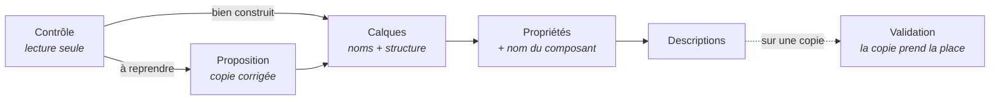

<p align="center">
  <a href="LICENSE"></a>
  
  
  
  <a href="https://mcqx7.github.io/ariane-skills/presentation.fr.html"></a>
</p>

<p align="center"><a href="README.md">English</a> · <b>Français</b></p>

# Ariane

**Une librairie Figma qu'une IA sait lire.**

Ariane est une suite de skills pour [Claude Code](https://claude.com/claude-code) qui
remet au propre les composants d'un design system Figma, pour qu'un agent (un
assistant de code, un générateur d'écrans) les comprenne sans deviner :

- **des noms qui disent la fonction**, en anglais, toujours les mêmes d'un run à
  l'autre : calques, propriétés, nom du composant ;
- **une structure sans coquilles vides** : les cadres qui ne servent à rien sont
  retirés, après avoir prouvé que le rendu ne bouge pas d'un pixel ;
- **des descriptions de composants fiables** : à quoi il sert, ce qu'il contient, où
  il vit, ce qu'il ne faut pas confondre avec lui.

Avant de toucher à quoi que ce soit, Ariane **contrôle** : elle dit si un composant
est assez bien construit, et sinon ce qu'il faut reprendre, en problèmes prêts à
devenir des tickets pour l'équipe du design system. Quand un composant est à
reprendre, elle peut en construire une **copie corrigée** au-dessus de l'original,
que tu relis avant qu'elle ne prenne sa place.

Tu décides à chaque étape. Ariane n'écrit rien sans le dire, et ne supprime jamais
l'ancien composant.

## Comment ça marche



1. **Le contrôle** lit un composant (ou une planche, ou plusieurs liens) et rend un
   verdict : « Bien construit » ou « À reprendre ». Il donne au plus cinq problèmes,
   chacun prêt à coller dans un ticket, au plus trois questions pour l'équipe du
   design system, et un plan de correction. Il n'écrit rien dans Figma.
2. **La proposition**, si tu la demandes : une copie corrigée d'après le plan, posée
   au-dessus de l'original. L'original et ses instances ne bougent pas.
3. **Le nommage**, dans un ordre fixe : les calques d'abord, puis les propriétés et
   le nom du composant, puis les descriptions. Chaque étape ne démarre que si la
   précédente est entièrement propre, sans question en suspens.
4. **La validation**, quand tu as relu la copie : elle prend le nom propre et la
   place de l'original ; l'ancien part sur une page « En attente de migration »,
   retiré de la publication, avec toutes ses instances intactes.
5. **Le remplacement dans les écrans**, plus tard et seulement si tu le demandes : les
   instances de l'ancien composant passent sur le nouveau, par lots, après un relevé
   et un essai.

Sur un **écran** (une maquette sans composant principal), Ariane ne fait que les
calques : il n'y a ni propriété ni description à écrire.

## Ce qu'il te faut

- **[Claude Code](https://claude.com/claude-code)**, avec un modèle Opus de préférence :
  Ariane a été mise au point sur Opus.
- **Le connecteur Figma officiel** (le serveur MCP de Figma), **avec l'écriture
  activée**. Ariane passe toujours par lui.
- **git**, pour récupérer Ariane et ses mises à jour.
- **Un siège Full ou Dev sur une offre Figma payante** (Professional, Organization ou
  Enterprise), et **un fichier qui appartient à cette offre**. Figma limite le nombre
  d'appels à son connecteur : 20 par mois avec l'offre gratuite (Starter) ou un siège
  View ou Collab, 200 par jour avec un siège Full ou Dev sur Professional ou
  Organization, 600 sur Enterprise ([les limites, chez Figma](https://developers.figma.com/docs/figma-mcp-server/rate-limits-access/)).
  Ariane lit beaucoup : 20 appels par mois ne suffisent pas pour un seul composant.
- Un fichier Figma de composants sur lequel tu as les droits d'édition.

## Installer

```bash
git clone https://github.com/MCQX7/ariane-skills.git
cd ariane-skills
claude
```

Les skills vivent dans `.claude/skills/` : ils sont actifs dès que tu ouvres Claude
Code dans ce dossier. C'est la façon la plus simple de travailler : un dossier par
design system, qui garde son lexique et sa mémoire.

**Pour les avoir dans tous tes projets**, pose un lien par dossier, depuis la racine
du dépôt :

```bash
mkdir -p ~/.claude/skills
for s in .claude/skills/*/; do
  ln -sfn "$PWD/${s%/}" ~/.claude/skills/"$(basename "$s")"
done
```

Le lien vers `ariane-referentiels/` est indispensable : chaque skill cherche ses
référentiels à côté de lui. S'il ne les trouve pas, il s'arrête et le dit, avant de
lire ou d'écrire quoi que ce soit dans Figma.

**Les mises à jour** : Ariane récupère elle-même la dernière version du dépôt
(`git pull`) au début de chaque run.

## Avant le premier run

### Le filet de sécurité

> [!CAUTION]
> **Sur une librairie publiée, travaille dans une branche Figma.** Un renommage de
> composant ou de propriété part chez tous les fichiers qui utilisent la librairie au
> moment où tu publies, et revenir à une ancienne version de ton fichier n'y change
> plus rien. La branche te donne en plus un comparatif relisible de tout ce qu'Ariane
> a fait. Sur un écran, l'historique des versions de Figma suffit.
>
> Ariane ne sait créer ni branche ni version : elle te demande de confirmer que le
> filet est en place.

### Ranger chaque composant dans une planche

Une copie corrigée se vérifie planche contre planche : l'original et sa copie, chacun
dans son cadre ou sa section. Un composant posé seul sur la page, hors de tout cadre,
se contrôle et se renomme sans problème, mais sa copie ne passe pas toute sa
vérification. Avant de demander une proposition, range le composant dans un cadre ou
une section.

### Les autorisations d'écriture

Ariane écrit son journal des descriptions, et le lexique ou le cadre quand tu valides
une ligne, dans `.claude/skills/ariane-referentiels/`. Claude Code protège tout ce qui
se trouve sous `.claude/` : il te demande ton accord avant d'y écrire, et une session
lancée sans personne (`claude -p`) ne peut pas y écrire du tout.

### Raconter ton produit à Ariane

Trois fichiers de `.claude/skills/ariane-referentiels/` appartiennent à ta mission.
Ils sont livrés vides, et Ariane fonctionne sans eux :

| Fichier | Ce qu'il porte | Qui l'écrit |
|---|---|---|
| `cadre-mission.md` | ce que le fichier Figma ne dit pas : les contraintes de ton design system (comment il porte ses marques, ses thèmes), les règles de ton produit (un texte figé, une composition interdite), tes réponses aux questions d'usage du contrôle | toi ; Ariane propose des lignes en fin de run, écrites seulement si tu les valides |
| `lexique-mission.md` | le vocabulaire de ton domaine : les mots de ton métier et leur traduction, les noms de tes produits, les options propres à ton projet | Ariane propose, tu valides ; tu peux aussi y écrire d'avance ce que tu sais |
| `journal-descriptions.md` | la mémoire des descriptions validées, pour retrouver les composants voisins d'une session à l'autre | Ariane seule, après ton GO |

Le cadre est celui qui sert le plus : quelques lignes sur ce que ton produit impose
évitent au contrôle de te poser des questions dont tu connais la réponse.

Quand tu changes de design system, ces trois fichiers se vident. Les autres
référentiels (conventions de nommage, patterns d'interface, types de composants
d'après des design systems publics) sont du métier : ils restent.

## Un premier run, pas à pas

Ouvre Claude Code dans le dossier d'Ariane, copie le lien d'un composant (ou d'une
planche de composants) dans Figma, et parle normalement. La seule porte d'entrée est
`/ariane-orchestrator`, mais tu n'as pas besoin de la nommer : une demande Figma suffit.

1. **Contrôler** — « Vérifie ce composant : `<lien>` ».
   Tu reçois le verdict, les problèmes, les questions pour le design system et le
   plan. S'il y a une question d'usage (« ce composant sert-il aussi à… ? »), Ariane
   te la pose et complète le plan avec ta réponse. Puis elle te demande la suite.
2. **Choisir la suite** — trois choix, chacun dit ce qu'il fait :
   - *construire la proposition* (seulement si le verdict est « À reprendre ») : une
     copie corrigée au-dessus de l'original, puis son nommage complet ;
   - *renommer* : calques, propriétés et descriptions, directement sur le composant ;
   - *s'arrêter là* : rien n'est écrit.
3. **Répondre aux questions** — quand un nom bute vraiment, Ariane le marque `❓` et
   te demande de trancher avant de continuer. Les descriptions te sont montrées
   avant d'être écrites : rien ne s'écrit sans ton GO.
4. **Relire la copie** — dans Figma, à côté de l'original. Un retour se donne en
   clair (« sur la copie, le bouton doit… ») et s'applique sur cette copie.
5. **Valider** — « La copie est validée : `<lien de la proposition>` ». La copie
   prend la place, l'ancien part en attente de migration, les descriptions du
   fichier suivent.
6. **Plus tard, migrer les écrans** — « Remplace l'ancien composant par le nouveau
   dans les écrans de ce fichier ». Ariane ne le propose jamais d'elle-même.

Tu peux aussi contrôler plusieurs composants d'un coup (« contrôle ces planches »,
avec plusieurs liens), ou passer un écran entier au propre (« mets cet écran au
propre »).

## Langue

Ariane est écrite **en français** : elle te parle en français, ses tickets et ses
descriptions sont en français. **Les noms qu'elle pose sont en anglais** (calques,
propriétés, composants), selon des conventions fixes : camelCase, `show`/`is`/`has`
pour les booléens, la fonction plutôt que l'apparence.

## Temps et coût

Ariane lit beaucoup avant d'écrire, et c'est voulu : un nom stable et une
description juste demandent de connaître tout le composant. Compte une session
longue par composant traité en entier (contrôle, copie, nommage) : de l'ordre
d'une demi-heure, et de quelques dollars à une quinzaine sur Opus selon
la taille du composant. Le contrôle seul est bien plus court. Lance d'abord un seul
composant pour mesurer chez toi.

## Ce qu'Ariane ne fait pas

- **Elle ne supprime jamais l'ancien composant** : il est renommé, mis à part et
  retiré de la publication ; ses instances restent en place jusqu'à la migration.
- **Elle ne juge pas la complétude** : un état qui manque n'est pas un défaut pour le
  contrôle. Elle juge ce qui est construit.
- **Elle ne crée ni branche, ni version, ni publication** dans Figma : c'est toi qui
  publies.
- **Elle ne touche pas aux autres fichiers** : seulement à celui dont tu donnes le lien.
- **Elle ne remplace rien dans les écrans** sans que tu le demandes explicitement.
- **Elle ne remplit pas le lexique seule** : chaque mot nouveau attend ta validation.

## Les skills

| Skill | Rôle |
|---|---|
| `ariane-orchestrator` | la porte d'entrée : détecte la cible, enchaîne les étapes, route le contrôle, la proposition, la validation et le remplacement |
| `ariane-check-component` | le contrôle, en lecture seule |
| `ariane-rebuild-component` | la proposition : une copie corrigée d'après le plan, vérifiée par un script fixe |
| `ariane-rename-layers` | les calques et la structure (retrait des cadres inutiles, prouvé au pixel) |
| `ariane-rename-props` | les propriétés et le nom du composant |
| `ariane-describe-components` | les descriptions des composants |
| `ariane-replace-instances` | le remplacement dans les écrans, sur demande seulement |
| `ariane-referentiels/` | les conventions, les patterns, les types de composants, et les trois fichiers de ta mission |

## Versions

Ce qui change d'une version à l'autre : [`CHANGELOG.md`](CHANGELOG.md).

## Licence

[MIT](LICENSE).
