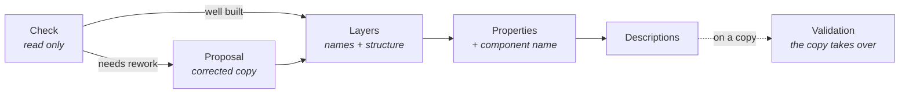

<p align="center">
  <a href="LICENSE"></a>
  
  
  
</p>

<p align="center"><b>English</b> · <a href="README.fr.md">Français</a></p>

# Ariane

**A Figma library that an AI can read.**

Ariane is a suite of skills for [Claude Code](https://claude.com/claude-code) that
cleans up the components of a Figma design system, so that an agent (a coding
assistant, a screen generator) understands them without guessing:

- **names that say what things do**, in English, the same from one run to the next:
  layers, properties, the component's name;
- **a structure without empty shells**: frames that do nothing are removed, after
  proving that the rendering doesn't move by a single pixel;
- **reliable component descriptions**: what it's for, what it contains, where it
  lives, what it shouldn't be confused with.

Before touching anything, Ariane **checks**: it tells you whether a component is
built well enough, and if not, what needs reworking, as issues ready to become
tickets for the design system team. When a component needs reworking, it can build
a **corrected copy** above the original, which you review before it takes its place.

You decide at every step. Ariane never writes anything without saying so, and never
deletes the old component.

> [!NOTE]
> **Ariane is written in French.** Expect French in its verdicts, tickets and
> descriptions. **The names it sets are in English**. See [Language](#language).

## How it works



1. **The check** reads a component (or a board, or several links) and gives a
   verdict: "well built" or "needs rework". It lists at most five issues, each ready
   to paste into a ticket, at most three questions for the design system team, and a
   plan to fix it. It writes nothing in Figma.
2. **The proposal**, if you ask for it: a copy corrected according to the plan,
   placed above the original. The original and its instances don't move.
3. **Naming**, in a fixed order: layers first, then properties and the component's
   name, then descriptions. Each step only starts if the previous one is entirely
   clean, with no open question.
4. **Validation**, once you've reviewed the copy: it takes the proper name and the
   original's place; the old one moves to a "waiting for migration" page, removed
   from publishing, with all its instances intact.
5. **Replacing in screens**, later and only if you ask: instances of the old
   component move to the new one, in batches, after a survey and a dry run.

On a **screen** (a mockup with no main component), Ariane only handles layers:
there are no properties or descriptions to write.

## What you need

- **[Claude Code](https://claude.com/claude-code)**, preferably with an Opus model:
  Ariane was tuned on Opus.
- **The official Figma connector** (Figma's MCP server), **with write access
  enabled**. Ariane always goes through it.
- **git**, to get Ariane and its updates.
- A Figma components file you can edit.

## Install

```bash
git clone https://github.com/MCQX7/ariane-skills.git
cd ariane-skills
claude
```

The skills live in `.claude/skills/`: they're active as soon as you open Claude Code
in this folder. That's the simplest way to work: one folder per design system, which
keeps its own lexicon and memory.

**To have them in all your projects**, add one link per folder, from the root of the
repository:

```bash
mkdir -p ~/.claude/skills
for s in .claude/skills/*/; do
  ln -sfn "$PWD/${s%/}" ~/.claude/skills/"$(basename "$s")"
done
```

The link to `ariane-referentiels/` is essential: each skill looks for its reference
files next to itself. If it can't find them, it stops and says so, before reading or
writing anything in Figma.

**Updates**: Ariane fetches the latest version of the repository itself (`git pull`)
at the start of each run.

## Before your first run

### The safety net

> [!CAUTION]
> **On a published library, work in a Figma branch.** Renaming a component or a
> property reaches every file that uses the library when you publish, and going back
> to an older version of your file no longer changes that. A branch also gives you a
> readable comparison of everything Ariane did. On a screen, Figma's version history
> is enough.
>
> Ariane can't create branches or versions: it asks you to confirm the safety net is
> in place.

### Telling Ariane about your product

Three files in `.claude/skills/ariane-referentiels/` belong to your project. They
ship empty, and Ariane works without them:

| File | What it holds | Who writes it |
|---|---|---|
| `cadre-mission.md` | what the Figma file doesn't say: your design system's constraints (how it carries its brands, its themes), your product's rules (a fixed text, a forbidden combination), your answers to the check's usage questions | you; Ariane suggests lines at the end of a run, written only if you approve them |
| `lexique-mission.md` | your domain's vocabulary: the words of your business and their translation, your product names, options specific to your project | Ariane suggests, you approve; you can also write what you already know in advance |
| `journal-descriptions.md` | the memory of approved descriptions, to find neighbouring components from one session to the next | Ariane only, after your GO |

The first one helps most: a few lines on what your product imposes save the check
from asking questions you already know the answer to.

When you move to another design system, these three files are emptied. The other
reference files (naming conventions, interface patterns, component types drawn from
public design systems) are about the craft: they stay.

## A first run, step by step

Open Claude Code in Ariane's folder, copy the link of a component (or a board of
components) in Figma, and just talk. The only entry point is `/ariane-orchestrator`,
but you don't need to name it: a Figma request is enough.

1. **Check** — "Check this component: `<link>`".
   You get the verdict, the issues, the questions for the design system and the plan.
   If there's a usage question ("is this component also used for…?"), Ariane asks you
   and completes the plan with your answer. Then it asks what's next.
2. **Choose what's next** — three choices, each saying what it does:
   - *build the proposal* (only if the verdict is "needs rework"): a corrected copy
     above the original, then its full naming;
   - *rename*: layers, properties and descriptions, directly on the component;
   - *stop here*: nothing is written.
3. **Answer the questions** — when a name really can't be decided, Ariane marks it
   `❓` and asks you to settle it before going on. Descriptions are shown to you
   before they're written: nothing is written without your GO.
4. **Review the copy** — in Figma, next to the original. Give feedback in plain words
   ("on the copy, the button should…"); it's applied to that copy.
5. **Validate** — "The copy is approved: `<proposal link>`". The copy takes over, the
   old one goes to "waiting for migration", the file's descriptions follow.
6. **Later, migrate the screens** — "Replace the old component with the new one in
   this file's screens". Ariane never suggests this on its own.

You can also check several components at once ("check these boards", with several
links), or clean up a whole screen ("clean up this screen").

## Language

Ariane is written **in French**: its verdicts, tickets and descriptions are in
French. **The names it sets are in English** (layers, properties,
components), following fixed conventions: camelCase, `show`/`is`/`has` for booleans,
function rather than appearance. Its naming conventions include a French-to-English
table of interface vocabulary: Ariane works best on a design system whose source
names are in French or English.

## Time and cost

Ariane reads a lot before writing, on purpose: a stable name and an accurate
description require knowing the whole component. Expect one long session per
component handled end to end (check, copy, naming): around half an hour, and from a
few dollars to about fifteen on Opus depending on the component's size. A check on
its own is much shorter. Run a single component first to measure it on your side.

## What Ariane doesn't do

- **It never deletes the old component**: it's renamed, set aside and removed from
  publishing; its instances stay in place until migration.
- **It doesn't judge completeness**: a missing state isn't a defect for the check. It
  judges what is built.
- **It doesn't create branches, versions or publish** in Figma: you publish.
- **It doesn't touch other files**: only the one you give the link to.
- **It doesn't replace anything in screens** unless you explicitly ask.
- **It doesn't fill the lexicon on its own**: every new word waits for your approval.

## The skills

| Skill | Role |
|---|---|
| `ariane-orchestrator` | the entry point: detects the target, chains the steps, routes the check, proposal, validation and replacement |
| `ariane-check-component` | the check, read only |
| `ariane-rebuild-component` | the proposal: a copy corrected according to the plan, verified by a fixed script |
| `ariane-rename-layers` | layers and structure (removal of useless frames, proven to the pixel) |
| `ariane-rename-props` | properties and the component's name |
| `ariane-describe-components` | component descriptions |
| `ariane-replace-instances` | replacing in screens, on request only |
| `ariane-referentiels/` | conventions, patterns, component types, and the three files of your project |

## Versions

What changes from one version to the next: [`CHANGELOG.md`](CHANGELOG.md).

## Licence

[MIT](LICENSE).
